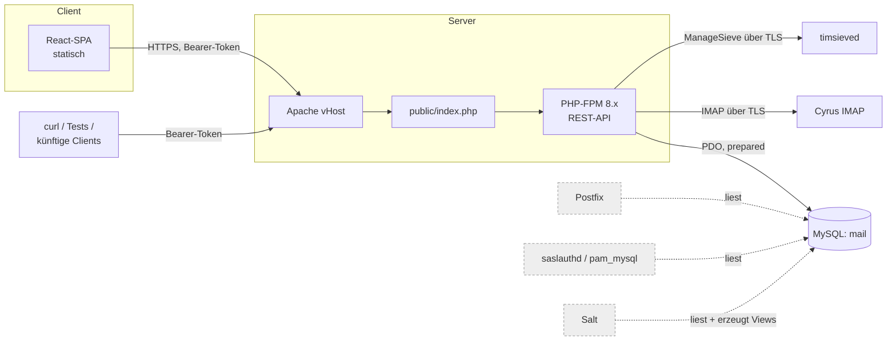
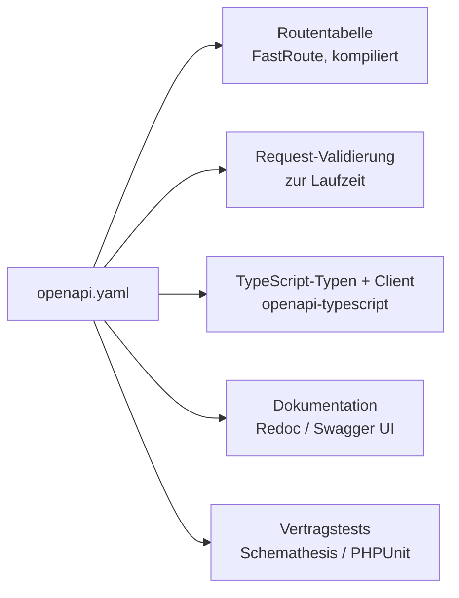
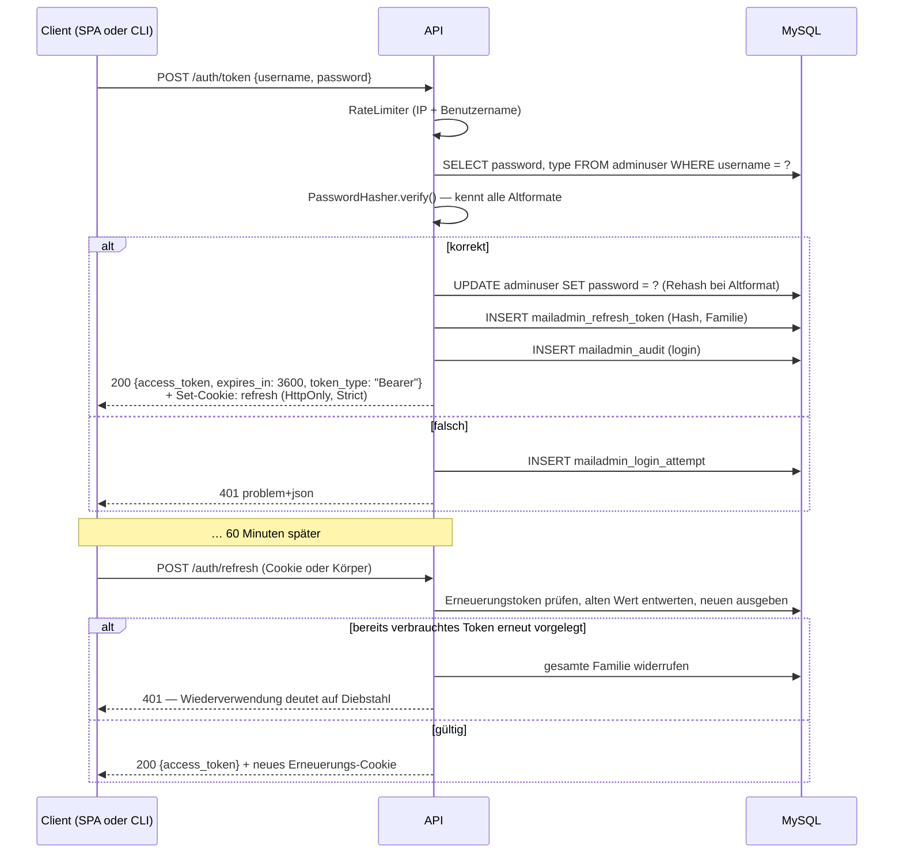

<!-- markdownlint-disable MD013 MD024 MD060 -->

# Architektur

> Dieses Dokument beschreibt bewusst **keine** Details des konkreten Produktivsystems — keine
> Hostnamen, Domains oder Serverpfade. Es ist damit veröffentlichungsfähig und liegt außerhalb
> von `docs/internal/`. Der Ist-Zustand, auf den es sich stützt, steht in
> `docs/internal/01-bestandsanalyse.md`; die zugrundeliegenden Festlegungen in
> `docs/internal/02-entscheidungen.md`.
>
> **Stand:** 2026-07-26

---

## 1. Leitplanken

| | Festlegung |
|---|---|
| E-1 | Bestehende Datenbank und Tabellen bleiben. Schemaerweiterungen migriert die Anwendung selbst. |
| E-2 | Cyrus bleibt Mailstore, hinter einer Schnittstelle. Loginform bleibt punktiert (`local.domain.tld`). |
| E-3 | Passwort-Rehash auf bcrypt läuft ohne PAM-Änderung — end-to-end verifiziert. |
| E-4 | Konfigurationshoheit bleibt geteilt: Anwendung schreibt nur die Datenbank. |
| E-5 | Eigenes Werkzeug, von Anfang an veröffentlichungsfähig. |
| E-6 | PHP 8 als API-Backend, React-SPA als Frontend — statisch ausgeliefert, keine Offline-Fähigkeit. |
| E-7 | Reines Admin-Werkzeug, kein Endnutzer-Selfservice. |
| E-8 | Deployment als Verzeichnis im Web-Root unter Apache und PHP-FPM. |
| E-9 | Keine Abgleichsansicht gegen die Salt-generierte Konfiguration. |
| E-10 | Authentifizierung über JWT, Zugriffstoken 60 Minuten gültig. |
| E-11 | Saubere REST-API, OpenAPI-Schema als Vertrag — für Nutzung, Generierung und Test. |
| E-12 | PHP-Seite so schlank wie möglich: kein Full-Stack-Framework. |
| E-13 | Neue Passwörter modern gehasht, Bestandshashes bleiben gültig. Keine Umstellungskampagne. |
| E-14 | Namensschema (`dotted` / `fqun`) konfigurierbar — global, je Domain, je Konto erkannt. |
| E-15 | Zugriffstoken im `localStorage`; Erneuerungstoken bleibt im HttpOnly-Cookie. |
| E-16 | Mehrsprachigkeit von Beginn an; die API bleibt sprachneutral. |
| E-17 | Testumgebung über Docker, inklusive vollständiger Authentifizierungskette. |
| E-18 | Rollenmodell unverändert; keine Bestandsbereinigung; keine Passwortumstellung vorerst. |

Konstruktionsprinzipien:

1. **Die Datenbank ist fremdes Gebiet.** Mehrere Systeme lesen mit. Das Altschema wird nicht
   verbogen, sondern in der Repository-Schicht eingesperrt.
2. **Datenbank und Mailstore sind nicht transaktional koppelbar.** Jede Operation, die beide
   berührt, braucht eine definierte Reihenfolge, eine Kompensation und einen Ort, an dem
   Inkonsistenzen sichtbar werden.
3. **Das Schema ist der Vertrag.** Routen, Validierung, Frontend-Typen und Tests leiten sich
   aus einer einzigen OpenAPI-Datei ab, nicht aus verstreuten Annotationen.
4. **Der Server entscheidet, das Frontend zeigt nur an.**

---

## 2. Systemkontext



Die gestrichelten Kästen sind Mitleser, die wir nicht kontrollieren. Sie definieren den
Vertrag: `domain`, `accountuser`, `virtual`, `lists` und die Views `allusers` und
`validsenders` müssen jederzeit gültig bleiben.

Ein zweiter Client ist ab sofort erstklassig vorgesehen: Werkzeuge und Tests sprechen dieselbe
API mit demselben Token-Mechanismus wie die Oberfläche. Genau das war das Argument für Bearer-
statt Cookie-Authentifizierung.

---

## 3. Backend-Schichten

```text
public/            nur das ist im Web-Root erreichbar
  index.php        Front-Controller
  assets/          gebautes React-Bundle
openapi/
  openapi.yaml     der Vertrag — Quelle für Routen, Validierung, Typen, Tests
src/
  Http/            Middleware-Kette, Dispatcher, Handler (ein Handler je operationId)
  Application/     Use Cases — kein HTTP-Wissen
  Domain/          Entitäten, Value Objects, Regeln — kein SQL, kein IMAP
  Infrastructure/
    Persistence/   Repositories (PDO), Migrator
    Mailstore/     CyrusMailstore, CyrusSieve, IMAP-Client
    Security/      TokenIssuer, PasswordHasher, RateLimiter
config/
migrations/
tests/
var/cache/         kompilierte Routentabelle, geparste Spezifikation
```

`public/` liegt im Web-Root, alles andere darüber — die Lehre aus dem Altsystem, das seine
Konfiguration mit Klartext-Passwörtern im DocumentRoot liegen hatte.

### 3.1 Was „lean" konkret heißt (E-12)

Kein Full-Stack-Framework. Die API ist eine Middleware-Kette über PSR-7/PSR-15 plus ein
Dispatcher. Die Abhängigkeitsliste bleibt kurz genug, um sie als Einzelperson aktuell zu halten:

| Zweck | Paket | Warum |
|---|---|---|
| PSR-7/17 | `nyholm/psr7` | kleinste vollständige Implementierung |
| Middleware-Ausführung | schlanker eigener PSR-15-Dispatcher | rund 40 Zeilen, keine Abhängigkeit |
| Routing | `nikic/fast-route` | Routentabelle wird aus der Spezifikation kompiliert |
| Container | `php-di/php-di` | Autowiring spart viel Fabrik-Code |
| JWT | `firebase/php-jwt` | klein, verbreitet, gut geprüft |
| Schema-Validierung | `league/openapi-psr7-validator` | validiert gegen `openapi.yaml` |
| Logging | `monolog/monolog` | PSR-3, Standard |

Bewusst **nicht** dabei: ORM (das Altschema arbeitet gegen jede Konvention — Repositories mit
explizitem SQL über PDO sind hier klarer), Template-Engine (das Backend liefert nur JSON),
Migrationsframework (der eigene Migrator ist rund 150 Zeilen und erfüllt E-1 genauer), eigene
Validierungsbibliothek (die Spezifikation validiert bereits).

### 3.2 Warum kein ORM

Über einem Schema mit `prefix`-Pseudoschlüsseln, einer vierfach überladenen `virtual`-Tabelle
und zwei Namensräumen für dasselbe Konto wird ein ORM zur Last. Repositories mit explizitem SQL
machen jede Abfrage sichtbar, jede zu einem Prepared Statement und die Abbildung Altschema →
Fachmodell zu lesbarem Code.

### 3.3 Das Namensschema an genau einer Stelle lösen

Ein Konto hat mehrere Schreibweisen, und welche gilt, ist seit E-14 konfigurierbar:

```text
Adresse                greta.mustermann@example.at        (immer gleich)

Schema "dotted"        Cyrus-Benutzer  greta.mustermann.example.at
                       Spool-Pfad      greta^mustermann^example^at

Schema "fqun"          Cyrus-Benutzer  greta.mustermann@example.at
                       Spool-Pfad      domain/e/example.at/g/user/greta^mustermann
```

Zwei Regeln machen das beherrschbar:

**Der Cyrus-Benutzername wird erzeugt, nie zerlegt.** Aus `greta.mustermann.example.at` allein
ist nicht ableitbar, wo der Local Part endet — die Information steckt nur in
`accountuser.domain_name`. Das Value Object `MailboxIdentity` wird deshalb immer aus dem Tripel
(Local Part, Domain, Schema) konstruiert und leitet alle Darstellungsformen daraus ab.

**Das Schema eines bestehenden Kontos wird erkannt, nicht konfiguriert.** Die einzige
Zerlegung, die stattfindet, ist die Frage „enthält der gespeicherte Benutzername ein `@`" — und
die ist eindeutig, weil ein `@` im Cyrus-Benutzernamen nur der Domaintrenner sein kann. Ein
Konto behält damit immer das Schema, unter dem seine Mailbox tatsächlich liegt, unabhängig
davon, was in der Konfiguration steht.

Die Konfiguration bestimmt nur, welches Schema **neue** Konten bekommen, in drei Stufen:
Domain-Einstellung aus `mailadmin_domain_setting`, sonst globaler Vorgabewert
`MAILADMIN_NAMING_SCHEME`, sonst `dotted`.

> **Voraussetzung für `fqun`:** Die Domain muss in den Cyrus-`loginrealms` stehen, sonst
> scheitert die Anmeldung. Diese Liste erzeugt Salt und liegt nach E-9 außerhalb der Anwendung
> — die Oberfläche weist beim Umschalten darauf hin, prüfen kann sie es nicht.

Ein Konto zwischen den Schemata zu bewegen ist eine echte Operation (`renamemailbox`, und der
Nutzer muss seine Zugangsdaten ändern), kein Schalter. Sie wird je Konto oder je Domain
ausdrücklich bestätigt und nie automatisch ausgelöst — siehe Abschnitt 8.1.

> **Bekannte Fragilität im Bestand:** Der View `allusers` bildet die Adressform per
> `REPLACE(username, CONCAT('.', domain_name), '')`. `REPLACE` ersetzt *alle* Vorkommen — bei
> einem Local Part, der den Domainnamen enthält, liefert der View Unsinn. Wir ändern den View
> nicht (E-1), aber die Anwendung liest `accountuser` direkt.

### 3.4 Die überladene `virtual`-Tabelle

| Bedeutung | `alias` | `dest` | `username` |
|---|---|---|---|
| Adresse eines Kontos | `local@domain` | Cyrus-User | Cyrus-User |
| Alias auf ein Konto | `local@domain` | Cyrus-User | Cyrus-User |
| Catchall der Domain | `@domain` | Ziel | Ziel |
| Weiterleitung nach außen | Cyrus-User | externe Adresse | leer |

Die Anwendung modelliert vier explizite Typen (`MailboxAddress`, `Alias`, `CatchAll`,
`Forward`). Die Unterscheidung passiert einmal beim Lesen. Ein Eintrag, der in kein Muster
passt, wird als „unbekannt" geführt und **angezeigt** statt stillschweigend übergangen.

---

## 4. Der API-Vertrag: OpenAPI als Quelle (E-11)

> **Nachtrag aus der Umsetzung.** Drei Angaben dieses Abschnitts sind durch
> [05-umsetzungsentscheidungen.md](05-umsetzungsentscheidungen.md) überholt: das Schema ist
> **OpenAPI 3.0.3**, nicht 3.1 (U-2 — der gesetzte Validator unterstützt 3.1 nur unvollständig);
> die Spezifikation liegt **auf mehrere Dateien verteilt** und wird gebündelt (U-3), bleibt aber
> ein logisches Dokument; und **Redoc wird nicht ausgeliefert** — stattdessen liefert
> `/api/docs/openapi.json` den gebündelten Vertrag (U-9, U-30). Der ursprüngliche Grund dafür
> (Redoc bräuchte `style-src 'unsafe-inline'`) ist mit U-35 entfallen; die Entscheidung steht
> jetzt nur noch auf der zusätzlichen Abhängigkeit und wird unter O-12 neu bewertet.
> Property-basierte Vertragstests (Schemathesis) sind nicht eingerichtet, siehe U-16 und O-2.

Design-first, nicht annotationsgeneriert. `openapi/openapi.yaml` (OpenAPI 3.0.3) ist die einzige
Wahrheit; der Code richtet sich danach, nicht umgekehrt. Ein aus Annotationen erzeugtes Schema
ist ein Nebenprodukt und driftet — ein handgeschriebener Vertrag ist ein Vertrag.

Aus der einen Datei entstehen fünf Dinge:



**Routing über `operationId`.** Jede Operation im Schema trägt eine `operationId`; ein
Build-Schritt kompiliert daraus eine Routentabelle, die `operationId` auf eine Handler-Klasse
abbildet. Fehlt zu einer `operationId` ein Handler — oder existiert ein Handler ohne Operation
— schlägt der Build fehl. Spezifikation und Implementierung können damit **nicht** auseinanderlaufen.

**Validierung.** Eingehende Anfragen werden gegen das Schema validiert, auch in Produktion: das
ist die Eingabegrenze, und eine Ablehnung dort ist billiger als eine tiefer im Code. Die
geparste Spezifikation wird gecacht, damit das kein YAML-Parsen pro Anfrage bedeutet. Antworten
werden nur in Entwicklung und Test validiert — dort ist es ein Testwerkzeug, in Produktion
wäre es nur Aufwand.

**Frontend-Typen.** `openapi-typescript` erzeugt aus derselben Datei Typen für die React-App.
Eine Änderung am Vertrag, die das Frontend bricht, wird beim Typecheck sichtbar, nicht im
Betrieb.

**Tests.** Die Spezifikation ist ausführbar: property-basierte Vertragstests (Schemathesis)
fahren die API gegen das Schema; zusätzlich decken PHPUnit-Tests die Fachlogik ab.

**Erkundung.** Unter `/api/docs/openapi.json` liegt der gebündelte Vertrag — in Produktion
abgeschaltet, über `MAILADMIN_API_DOCS=1` einschaltbar (U-9). Ein Betrachter läuft im eigenen
Ursprung; die CSP wird dafür nicht aufgeweicht.

---

## 5. Authentifizierung (E-10)

### 5.1 Verfahren

Zugriff über **JWT als Bearer-Token, 60 Minuten gültig**. Das macht die API ohne Browser
nutzbar — `curl`, Tests, künftige Clients senden denselben Header — und beseitigt CSRF
weitgehend, weil ein Browser einen `Authorization`-Header nicht von selbst mitschickt.

Der Preis: ein Bearer-Token ist bis zum Ablauf gültig, wenn es abhandenkommt. Dagegen drei
Maßnahmen — kurze Laufzeit, Widerrufsliste, und die Art, wie das Token im Browser gehalten wird.

### 5.2 Token-Paar

| | Zugriffstoken | Erneuerungstoken |
|---|---|---|
| Form | JWT, signiert | undurchsichtiger Zufallswert, 256 Bit |
| Gültigkeit | 60 Minuten | 12 Stunden absolut |
| Speicherung serverseitig | keine (zustandslos, außer Widerrufsliste) | Hash in `mailadmin_refresh_token` |
| Übertragung an die SPA | Antwortkörper, im `localStorage` abgelegt | HttpOnly-Cookie, `SameSite=Strict`, Pfad auf den Erneuerungsendpunkt |
| Übertragung an API-Clients | Antwortkörper | Antwortkörper |

**Speicherort im Browser (E-15).** Das Zugriffstoken liegt im `localStorage`. Das ist die
bequemere Variante: die Anmeldung übersteht einen Reload ohne stillen Erneuerungsaufruf, und
das Verhalten entspricht dem, was Werkzeuge erwarten.

Der Preis ist real und soll benannt sein: **eine XSS-Lücke im Frontend liefert einem Angreifer
ein gültiges Administrator-Token** — bei einem Werkzeug, das Postfächer löschen und Passwörter
setzen kann. Deshalb hängt an dieser Entscheidung eine Reihe von Maßnahmen, die dadurch von
„gute Praxis" zu „tragend" werden:

- **Das Erneuerungstoken bleibt im HttpOnly-Cookie** und wandert nicht ebenfalls in den
  `localStorage`. Sonst wüchse das Zeitfenster eines gestohlenen Tokens von 60 Minuten auf
  12 Stunden — mit beliebiger Verlängerung durch den Angreifer.
- **Strenge Content-Security-Policy** (Abschnitt 5.7). Sie ist ab hier die wichtigste
  Einzelmaßnahme gegen XSS. Tragend ist dabei `script-src 'self'`: an das Token kommt nur, wer
  Skripte ausführen kann. `style-src` trägt seit U-35 `'unsafe-inline'` (Material UI); das
  berührt diesen Schutz nicht, kostet aber die Absicherung gegen Verunstaltung der Oberfläche.
- **60 Minuten bleiben 60 Minuten.** Die Laufzeit wird nicht erhöht, um Anmeldungen zu sparen.
- **Keine Fremdinhalte im Frontend:** keine externen Skripte, keine Analysebausteine, kein
  ungefiltertes Einsetzen von HTML.

### 5.3 Ansprüche im Token

Bewusst minimal:

```json
{ "iss": "mailadmin", "aud": "mailadmin-api", "sub": "<adminuser>",
  "role": "superuser|domainmaster", "jti": "<eindeutig>", "iat": …, "exp": … }
```

**Der Domain-Zuschnitt steht nicht im Token.** Er wird pro Anfrage aus `domainadmin` gelesen
(mit kurzlebigem Cache). Andernfalls würde eine entzogene Domain-Zuweisung bis zu 60 Minuten
weiterwirken — bei einem Werkzeug, das Postfächer löschen kann, ist das keine akzeptable Lücke.
`role` ist enthalten, weil sie sich praktisch nie ändert; bei einer Rollenänderung werden die
Token des Nutzers widerrufen.

Signatur: **EdDSA (Ed25519)**, Schlüssel aus der Umgebung. Asymmetrisch, damit ein späterer
zweiter Dienst Token prüfen kann, ohne sie ausstellen zu können. HS256 wäre die einfachere
Alternative, spart aber wenig.

### 5.4 Abläufe



**Rotation mit Wiederverwendungserkennung:** jedes Erneuerungstoken ist genau einmal gültig.
Taucht ein bereits verbrauchtes wieder auf, wurde es kopiert — dann wird die ganze
Token-Familie widerrufen und der Nutzer muss sich neu anmelden. Das ist der Standardweg, um
Diebstahl eines langlebigen Tokens zu begrenzen.

**Abmelden** (`POST /auth/logout`) entwertet die Erneuerungsfamilie und setzt die `jti` des
aktuellen Zugriffstokens auf die Widerrufsliste `mailadmin_token_denylist`, bis dessen `exp`
erreicht ist. Der Eintrag wird bei jeder Anfrage geprüft — eine indizierte Abfrage, dafür
sofortiger Widerruf statt bis zu 60 Minuten Nachlauf. Abgelaufene Einträge räumt ein
Wartungslauf ab.

### 5.5 Passwortprüfung mit Altformaten

`PasswordHasher.verify($klartext, $hash)` erkennt am Hash selbst:

| Format im Bestand | Prüfung | Bei Erfolg neu geschrieben als |
|---|---|---|
| `$argon2id$…`, `$2y$…` | `password_verify()` | unverändert |
| DES-crypt (13 Zeichen) | `crypt()` mit Hash als Salt | Zielformat |
| `$1$`, `$5$`, `$6$` | `crypt()` | Zielformat |
| SHA1-hex (40 Zeichen) | `hash_equals(sha1(pw), hash)` | Zielformat |
| MySQL `PASSWORD()` (41 Zeichen, `*`) | Nachbildung in PHP, kein DB-Roundtrip | Zielformat |
| Klartext | `hash_equals()` | Zielformat |

Zielformat ist kontextabhängig:

- `adminuser` → **Argon2id**. An dieser Tabelle hängt kein externer Konsument.
- `accountuser` → **bcrypt**. Muss `crypt(3)`-lesbar bleiben, weil `pam_mysql` mitprüft (E-3).

Alle Vergleiche über `hash_equals()`. Ein unbekannter Benutzername durchläuft eine
Dummy-Verifikation, damit die Antwortzeit nichts verrät.

**Wann neu gehasht wird (E-13):** bei jeder erfolgreichen Anmeldung prüft
`password_needs_rehash()`, ob der Hash dem aktuellen Verfahren und Kostenfaktor entspricht —
nur dann wird geschrieben. Für `adminuser` greift das bei jedem Login und hebt die
Bestandshashes nach und nach auf Argon2id. Für `accountuser` greift es nur, wenn ein
Administrator ein Passwort setzt, weil die Anwendung Endnutzer-Anmeldungen nicht sieht.

**Bestandshashes bleiben gültig.** Es gibt keine Umstellungskampagne: DES-crypt und SHA1
funktionieren über die bestehenden PAM-Zeilen (`crypt=1` und `crypt=4`) unverändert weiter,
beide bleiben dauerhaft erhalten. Damit S-2 dabei nicht unbeobachtet altert, zeigt die
Kontenliste das Hash-Format an und lässt danach filtern; eine gezielte Rücksetzung nach Domain
oder Format steht als Werkzeug bereit, ist aber keine Pflichtübung.

### 5.6 Missbrauchsschutz

Zähler pro IP **und** pro Benutzername in `mailadmin_login_attempt`, wachsende Verzögerung,
temporäre Sperre. Fehlversuche werden zusätzlich in einem Format geloggt, das ein
fail2ban-Filter auswerten kann — Abwehr gehört auch auf die Netzwerkebene.

### 5.7 Sicherheits-Header

Ausgeliefert vom Webserver bzw. vom Front-Controller, für alle Antworten:

| Header | Wert | Zweck |
|---|---|---|
| `Content-Security-Policy` | `default-src 'self'; script-src 'self'; style-src 'self' 'unsafe-inline'; img-src 'self' data:; connect-src 'self'; frame-ancestors 'none'; base-uri 'none'; object-src 'none'` | Tragend wegen E-15 — aber **über `script-src`**, nicht über `style-src`. Kein `unsafe-eval`, nirgends. `style-src 'unsafe-inline'` ist mit U-35 für Material UI zugelassen; Begründung und Grenzen dort. |
| `Strict-Transport-Security` | `max-age=31536000; includeSubDomains` | erzwingt HTTPS |
| `X-Content-Type-Options` | `nosniff` | verhindert MIME-Raten |
| `Referrer-Policy` | `no-referrer` | keine Pfade an Dritte |
| `Permissions-Policy` | restriktiv | keine Kamera, kein Mikrofon, keine Geolocation |
| `Cache-Control` | `no-store` auf allen API-Antworten | Verwaltungsdaten gehören nicht in den Cache |

Die CSP erlaubt bewusst keine Inline-Skripte. Der Frontend-Build darf also keine erzeugen —
das ist beim Bundler zu konfigurieren und gehört in die Abnahmekriterien.

---

## 6. Autorisierung

Der Altcode löste das mit einer 44 KB großen `switch`-Anweisung, die pro Aktion eine boolesche
Variable setzte: weder prüfbar noch testbar.

Neues Modell — **deny by default**, verankert im Schema:

1. Jede Operation in `openapi.yaml` deklariert über eine Erweiterung `x-permission` die
   benötigte Berechtigung, etwa `account:write`. Eine Operation **ohne** Deklaration lässt der
   Build nicht durch. Ein vergessener Marker ist ein Buildfehler, keine offene Tür.
2. Jeder Use Case bekommt einen `ActorContext` (wer, Rolle, sichtbare Domains) als ersten
   Parameter. Nicht optional — man kann ihn nicht vergessen.
3. Ressourcenbezogene Prüfungen liegen in Policy-Objekten: `DomainPolicy::mayWrite()`,
   `AccountPolicy::mayDelete()`. Kleine, direkt testbare Einheiten.
4. **Jede Objektabfrage ist domain-gescoped.** Ein Domainmaster, der eine fremde Konto-ID
   errät, bekommt `404`, nicht `403` — die Existenz fremder Objekte wird nicht bestätigt.

**Das Rollenmodell bleibt bei zwei Rollen** (E-18): Superuser und Domainmaster, Zuschnitt über
`domainadmin`. Rollen werden trotzdem auf Berechtigungsmengen abgebildet statt direkt geprüft —
das kostet nichts und hielte eine spätere Verfeinerung offen, ohne den Code anzufassen.

---

## 7. Die REST-API

### 7.1 Konventionen

- Basis `/api/v1`, JSON, UTF-8. Kein HTML aus dem Backend außer dem SPA-Einstiegspunkt.
- Ressourcen sind Substantive im Plural, Operationen sind HTTP-Methoden. Keine Verben in Pfaden
  außer bei den beiden Vorgängen, die keine Ressource sind (`/auth/token`, `/auth/refresh`).
- Fehler als `application/problem+json` (RFC 9457): `type`, `title`, `status`, `detail`,
  `instance`, dazu `errors` als Feld→Meldung-Abbildung bei Validierungsfehlern. Im Schema als
  wiederverwendbare Antwort definiert, damit jeder Endpunkt dieselbe Fehlerform hat.
- **Die API ist sprachneutral** (E-16). Jeder Fehler trägt zusätzlich ein stabiles Feld
  `code` (etwa `account.quota_exceeded`), anhand dessen das Frontend übersetzt. `title` und
  `detail` bleiben englische Rückfalltexte. Eine übersetzte Meldung als Vertragsbestandteil
  wäre weder testbar noch für andere Clients brauchbar.
- Jede Antwort trägt `X-Request-Id`, die auch im Log steht.
- Paginierung `?page` und `?per_page`, `meta.total` in der Antwort. Sortierung und Filter
  **ausschließlich** über im Schema aufgezählte Werte — das Altsystem interpolierte `ORDER BY`
  aus der Session direkt ins SQL.
- Nebenläufigkeit: `GET` liefert ein `ETag` (Hash des Datensatzes), schreibende Methoden
  akzeptieren `If-Match`, Abweichung ergibt `412`. Kostet kein Schema und verhindert, dass zwei
  Administratoren einander überschreiben.
- Statuscodes konsequent: `201` mit `Location` beim Anlegen, `204` ohne Körper beim Löschen,
  `409` bei fachlichen Konflikten, `422` bei Validierungsfehlern, `412` bei `If-Match`-Konflikt.

### 7.2 Ressourcen

| Methode und Pfad | Zweck |
|---|---|
| `POST /auth/token` | Anmelden, Token-Paar ausstellen |
| `POST /auth/refresh` | Zugriffstoken erneuern, Erneuerungstoken rotieren |
| `POST /auth/logout` | Familie widerrufen, `jti` auf die Widerrufsliste |
| `GET /auth/me` | Aktueller Akteur, Rolle, Berechtigungen, sichtbare Domains |
| `GET/POST /domains` · `GET/PATCH/DELETE /domains/{domain}` | Domainverwaltung |
| `GET/POST /domains/{domain}/accounts` | Konten einer Domain |
| `GET/PATCH/DELETE /accounts/{id}` | Konto |
| `PUT /accounts/{id}/password` | Passwort setzen |
| `GET/PUT /accounts/{id}/quota` | Quota (Quelle: Cyrus) |
| `GET/PUT/DELETE /accounts/{id}/vacation` | Abwesenheitsnotiz über Sieve |
| `GET/PUT /accounts/{id}/forwards` | Weiterleitungen |
| `GET/POST /domains/{domain}/aliases` · `DELETE /aliases/{id}` | Aliase |
| `GET/PUT/DELETE /domains/{domain}/catchall` | Catchall |
| `GET/POST /admins` · `GET/PATCH/DELETE /admins/{username}` | Adminverwaltung, nur Superuser |
| `GET/POST /lists` · `PATCH/DELETE /lists/{id}` | Mailinglisten |
| `POST /maintenance/password-resets` | Massen-Passwortrücksetzung (E-7) |
| `GET /maintenance/reconciliation` | Abweichungen Datenbank ↔ Mailstore |
| `GET /health` | Erreichbarkeit von Datenbank, IMAP, ManageSieve |

Quota ist bewusst eine eigene Ressource: der Wert lebt in Cyrus, nicht in der Datenbank. Ihn in
die Konto-Darstellung zu mischen würde verschleiern, dass jeder Lesezugriff eine IMAP-Runde
kostet. Kontenlisten liefern Quota deshalb **nicht** mit — das Altsystem fragte pro Konto
einzeln ab und wurde bei großen Domains entsprechend langsam. Die Oberfläche lädt Quota
gebündelt über eine Verbindung nach.

### 7.3 CSRF

Mit Bearer-Token im `Authorization`-Header entfällt der klassische CSRF-Angriff: ein Browser
schickt diesen Header nicht von selbst mit. Zu schützen bleibt genau ein Endpunkt —
`POST /auth/refresh`, der im Browser das Cookie verwendet. Dort greifen `SameSite=Strict`, die
Beschränkung auf `POST` und ein enger Cookie-Pfad.

Verändernde Operationen laufen nie über `GET`. Im Altsystem löschte ein `GET` eine Domain.

---

## 8. Konsistenz zwischen Datenbank und Mailstore

MySQL-Transaktionen umfassen Cyrus nicht. Das Altsystem feuerte beides nacheinander ab und
prüfte das Ergebnis nicht.

### 8.1 Reihenfolge nach Schadensbild

Die Regel: **so scheitern, dass niemand Mail verliert.**

**Konto anlegen — Mailstore zuerst:**

```text
1. Mailbox anlegen, ACL setzen, Quota setzen
2. DB-Transaktion: INSERT accountuser + INSERT virtual, commit
3. Optionale Standardordner anlegen
```

Scheitert Schritt 2, bleibt eine verwaiste Mailbox: unsichtbar, es wird nichts zugestellt,
niemand merkt etwas. Umgekehrt würde Postfix sofort Mail für eine Adresse annehmen, deren
Mailbox fehlt — Bounces. Die Kompensation (Mailbox wieder entfernen) läuft trotzdem, ihr
Fehlschlagen ist aber harmlos.

**Konto löschen — Datenbank zuerst:**

```text
1. DB-Transaktion: DELETE virtual + DELETE accountuser, commit
2. Mailbox löschen
```

Nach Schritt 1 fließt keine Mail mehr. Scheitert Schritt 2, bleibt eine verwaiste Mailbox, die
die Abgleichsfunktion meldet.

**Domain umbenennen** ist die teuerste Operation: `renamemailbox` über *alle* Konten, weil der
Domainname im Cyrus-Usernamen steckt. Das Altsystem änderte nur die Datenbank — die Konten
waren danach nicht mehr erreichbar. Neu: eine ausdrücklich bestätigte Batch-Operation mit
Fortschritt, Protokoll und Abbruch, oder Verweigerung, wenn der Mailstore nicht erreichbar ist.

**Namensschema eines Kontos wechseln** (E-14) folgt demselben Muster: `renamemailbox` von
`user/local.domain.tld` nach `user/local@domain.tld` oder zurück, danach `accountuser.username`
und die zugehörigen `virtual`-Einträge anpassen. Mailstore zuerst, damit ein Abbruch die
Zustellung nicht ins Leere laufen lässt.

Zwei Dinge unterscheiden diesen Vorgang von den übrigen:

- **Der Nutzer muss seine Zugangsdaten ändern.** Die Operation wird nie automatisch ausgelöst,
  sondern je Konto oder je Domain ausdrücklich bestätigt, mit klarer Ansage, wer danach etwas
  tun muss.
- **Für `fqun` muss die Domain in den `loginrealms` stehen.** Das kann die Anwendung nicht
  prüfen (E-9) und nicht herstellen (E-4). Sie warnt und verlangt eine Bestätigung, dass die
  Voraussetzung erfüllt ist.

### 8.2 Reparaturweg

Jede erkannte Inkonsistenz landet in `mailadmin_repair_queue`: was war beabsichtigt, welcher
Schritt scheiterte, welcher Zustand ist erreicht. Zwei Konsumenten:

- eine Ansicht, die offene Punkte zeigt und einen erneuten Versuch anbietet,
- `GET /maintenance/reconciliation`, die unabhängig prüft:
  - `accountuser`-Einträge ohne Mailbox,
  - Mailboxen ohne `accountuser`-Eintrag, **in beiden Cyrus-Namensräumen** — also auch die
    Schatten-Postfächer aus dem virtdomains-Baum, die das Altsystem nie anzeigte,
  - `virtual`-Einträge, die auf nicht existierende Konten zeigen.

---

## 9. Mailstore-Anbindung

### 9.1 Schnittstellen

```php
interface Mailstore {
    public function createMailbox(MailboxIdentity $id): void;
    public function deleteMailbox(MailboxIdentity $id): void;
    public function renameMailbox(MailboxIdentity $from, MailboxIdentity $to): void;
    public function mailboxExists(MailboxIdentity $id): bool;
    public function listMailboxes(string $pattern): iterable;
    public function getQuota(MailboxIdentity $id): Quota;
    public function setQuota(MailboxIdentity $id, Quota $q): void;
    public function getAcl(MailboxIdentity $id): AclSet;
    public function setAcl(MailboxIdentity $id, string $subject, Acl $acl): void;
}

interface SieveStore {
    public function activeScript(MailboxIdentity $id): ?SieveScript;
    public function putScript(MailboxIdentity $id, SieveScript $s): void;
    public function activate(MailboxIdentity $id, string $name): void;
    public function deleteScript(MailboxIdentity $id, string $name): void;
}
```

Kein IMAP-Detail dringt darüber hinaus. Das dient zuerst der **Testbarkeit** — Use Cases werden
gegen eine In-Memory-Attrappe getestet — und erst danach einem möglichen Dovecot-Wechsel (E-2).

### 9.2 Der IMAP-Client

Selbst geschrieben, klein und getestet. `ext-imap` ist ab PHP 8.4 nicht mehr Teil des Kerns und
war für Admin-Kommandos wie `SETQUOTA`, `SETACL` und das Anlegen im `user/`-Namensraum ohnehin
nie gedacht.

Anforderungen, an denen der Altclient scheiterte:

- **TLS ist Pflicht**, mit Zertifikatsprüfung. Der Altclient sprach Klartext auf Port 143 und
  schickte das Admin-Passwort ungeschützt.
- **Korrektes Quoting und Literale** statt gehoffter Anführungszeichen.
- **Eindeutige Command-Tags** statt des konstanten `.`, damit Antworten zuordenbar sind.
- **Timeouts** auf Verbindung und Lesevorgang — der Altclient konnte endlos hängen.
- **Verbindungs-Wiederverwendung** innerhalb einer Anfrage.

### 9.3 Standardordner ohne das Nutzerpasswort

Das Altsystem meldete sich **als der neue Nutzer mit dessen Klartextpasswort** an, um Ordner
anzulegen und zu abonnieren. Mit gehashten Passwörtern unmöglich — und auch vorher falsch.

Stattdessen SASL-Proxy-Authentifizierung: der Administrator authentifiziert sich mit eigenen
Anmeldedaten und gibt den Zielnutzer als Autorisierungsidentität an (`authzid` = Zielnutzer,
`authcid` = Admin). Damit lassen sich Ordner im Namen des Nutzers anlegen und abonnieren, ohne
dessen Passwort zu kennen.

### 9.4 Sieve: erzeugen statt patchen

Das Altsystem hielt Abwesenheitsnotiz und Weiterleitung in **einem** Skript und schob sie per
regulärem Ausdruck ineinander — eine verlässliche Quelle subtiler Fehler.

Neu: ein strukturiertes Modell (`SieveRuleSet` aus Vacation-, Redirect- und Filterregeln) wird
vollständig gerendert, nie gelesen-und-gepatcht. Erzeugte Skripte tragen eine Markierung im
Kopf; findet die Anwendung ein aktives Skript **ohne** diese Markierung, überschreibt sie es
nicht, sondern zeigt es schreibgeschützt an und verlangt eine ausdrückliche Übernahme.

---

## 10. Datenzugriff und Migrator

### 10.1 Zugriff

PDO im Ausnahmemodus, `ATTR_EMULATE_PREPARES = false`, ausschließlich Prepared Statements. Kein
Query-String wird aus Eingaben zusammengesetzt — auch nicht für `ORDER BY`, dort greift die
Aufzählung aus dem Schema.

Der Datenbankbenutzer der Anwendung sollte **nicht** derselbe sein wie der von Postfix und
`pam_mysql`: eigener Benutzer mit Schreibrechten auf die verwalteten Tabellen, Leserechten auf
die Views. Das ist Serverkonfiguration, keine Anwendungsänderung — aber die Anwendung setzt es
voraus und die Installationsanleitung beschreibt es.

### 10.2 Migrator

- Versionstabelle `mailadmin_schema_version`. Fehlt sie, wird ein unmigrierter Bestand
  angenommen — der Normalfall beim ersten Start.
- Migrationen vorwärtsgerichtet, nummeriert, idempotent, protokolliert.
- **Nur additiv**, solange webcyradm parallel läuft: neue Tabellen, neue Spalten mit Default.
  Kein `DROP`, kein `RENAME`, keine Typverengung an Bestandsspalten.
- Alle neuen Tabellen mit Präfix `mailadmin_`.

**Präzisierung zu E-1:** Automatische Migration bei jeder Web-Anfrage ist riskant
(Nebenläufigkeit, halbe Zustände unter Last). Stattdessen:

1. `bin/migrate` führt die Migrationen aus, abgesichert durch eine Datenbanksperre — der Weg
   für ein Deployment.
2. Die Web-Anwendung **prüft** beim Start die Version und verweigert den Dienst mit klarer
   Meldung, wenn sie veraltet ist. Sie migriert nicht selbst.
3. Für einfache Installationen gibt es einen ausdrücklich einzuschaltenden Schalter
   `MAILADMIN_AUTO_MIGRATE`, der Schritt 1 beim ersten Zugriff unter Sperre ausführt.

„Die Anwendung macht das selbst" bleibt damit erfüllt, ohne dass ein Deployment unter Last
mitten in einer Migration steht.

### 10.3 Neue Tabellen

| Tabelle | Zweck |
|---|---|
| `mailadmin_schema_version` | Migrationsstand |
| `mailadmin_audit` | Revisionsprotokoll |
| `mailadmin_login_attempt` | Missbrauchsschutz |
| `mailadmin_refresh_token` | Erneuerungstoken (Hash, Familie, Verbrauch) |
| `mailadmin_token_denylist` | widerrufene `jti` bis zu ihrem Ablauf |
| `mailadmin_repair_queue` | offene Inkonsistenzen Datenbank ↔ Mailstore |
| `mailadmin_domain_setting` | Vorgaben je Domain, u.a. Namensschema (E-14) |
| `mailadmin_setting` | Anwendungseinstellungen, sofern nicht aus der Umgebung |

Keine davon wird von einem anderen System gelesen — sie sind frei gestaltbar.

---

## 11. Frontend

### 11.1 Aufbau

React als Single-Page-Anwendung, zu statischen Dateien gebaut, aus `public/assets/`
ausgeliefert. Die API liegt same-origin unter `/api` — kein CORS nötig. Der vHost liefert für
unbekannte Pfade unterhalb des Anwendungsverzeichnisses die `index.html`, damit clientseitiges
Routing funktioniert; `/api/*` geht an den Front-Controller.

**Komponenten kommen von Material UI** (`@mui/material`, U-35). Roboto und die Material Icons
werden **lokal gebündelt** (`@fontsource/roboto`, `@mui/icons-material`) — kein Google-Fonts-CDN,
weder aus Bequemlichkeit noch als Rückfall. `default-src 'self'` verbietet es, und Abschnitt 5.2
tut es ohnehin.

MUI stylt zur Laufzeit über Emotion und schreibt dabei `<style>`-Elemente in das Dokument;
deshalb trägt `style-src` in Abschnitt 5.7 `'unsafe-inline'`. `script-src` bleibt unangetastet —
die Abwägung samt verworfener Alternativen steht in U-35.

### 11.2 Zusammenspiel mit der API

- **Generierter Client.** `openapi-typescript` erzeugt Typen aus `openapi.yaml`; darüber ein
  dünner Fetch-Wrapper, der `Authorization` setzt, `problem+json` auswertet und `401` behandelt.
  Kein handgepflegtes API-Modul, das gegenüber dem Vertrag driftet.
- **Zugriffstoken im `localStorage`** (E-15). Bei `401` ruft der Wrapper einmalig
  `POST /auth/refresh` und wiederholt die Anfrage; scheitert auch das, geht es zur Anmeldung.
  Parallele `401` werden zu einem Erneuerungsversuch gebündelt.
- **Abmelden räumt beides ab:** den `localStorage`-Eintrag und das Erneuerungs-Cookie. Ein
  liegengebliebenes Token nach dem Abmelden wäre der schlimmste Fall dieser Speicherwahl.
- **Nach einem Reload gilt das gespeicherte Token weiter**, solange es nicht abgelaufen ist;
  danach greift die Erneuerung über das Cookie.
- **Serverzustand** über eine Query-Bibliothek (etwa TanStack Query) mit expliziter
  Invalidierung nach Mutationen. Kein globaler Speicher für Daten, die dem Server gehören.
- **Optimistische Aktualisierung nur bei harmlosen Operationen.** Löschvorgänge und
  Passwortänderungen warten auf die Antwort.
- **Berechtigungen kommen vom Server** über `GET /auth/me`; die Oberfläche blendet danach aus.
  Das ist Komfort — die Durchsetzung liegt im Backend, und die Oberfläche behandelt `403`
  trotzdem sauber.
- **Fehlerdarstellung** direkt aus `problem+json`: `errors` auf Formularfelder abgebildet,
  `title`/`detail` als Meldung, `X-Request-Id` für Rückfragen eingeblendet.

### 11.3 Auslieferung und Zwischenspeicherung

Das Frontend ist eine reine Single-Page-Application: gebautes HTML, CSS und JavaScript,
ausgeliefert als statische Dateien. **Kein Service Worker, kein Web-App-Manifest, keine
Offline-Fähigkeit, keine Installierbarkeit.** Für ein Administrationswerkzeug hinter Anmeldung
brächte Offline-Betrieb keinen Nutzen und wäre bei Löschvorgängen sogar riskant.

Zwischenspeicherung erledigen ausschließlich HTTP-Header:

- Assets tragen einen Inhalts-Hash im Dateinamen und werden mit langer Gültigkeit und
  `immutable` ausgeliefert.
- `index.html` wird nie zwischengespeichert, damit ein Deployment sofort greift.
- API-Antworten sind grundsätzlich `no-store` — Verwaltungsdaten gehören nicht in einen
  Browser-Cache.

**Die Sicherheits-Header aus Abschnitt 5.7 müssen auch an der statisch ausgelieferten
`index.html` hängen.** Heute setzt sie allein der Front-Controller, also nur für `/api/*` — die
Shell, in der eine XSS-Lücke überhaupt erst wirksam würde, bekommt keine. W1 schließt das über
`public/.htaccess` und die vHost-Beispiele oder durch Auslieferung der Shell über den
Front-Controller (offener Punkt O-13).

### 11.4 Mehrsprachigkeit

Von Beginn an eingeplant (E-16), auch wenn zunächst nur Deutsch ausgeliefert wird.

- **Keine festverdrahteten Texte.** Jede sichtbare Zeichenkette läuft über einen Textschlüssel;
  eine Übersetzungsbibliothek (etwa `react-i18next`) löst sie auf.
- **Fehlermeldungen aus dem Code, nicht aus dem Text.** Die API liefert je Fehler ein stabiles
  `code`-Feld; das Frontend bildet es auf einen übersetzten Text ab. Ist ein Code unbekannt,
  wird `title`/`detail` aus der Antwort als Rückfall angezeigt — die Oberfläche bleibt damit
  auch bei neuen Fehlerarten benutzbar.
- **Sprachwahl** aus `Accept-Language`, überschreibbar je Administrator; die Präferenz liegt in
  `mailadmin_admin_setting`.
- **Datum, Zahlen und Speichergrößen** über `Intl`, nicht handgebaut. Gerade Quota-Angaben
  unterscheiden sich in Trennzeichen und Einheitenschreibweise.
- **Übersetzungsdateien werden geprüft:** ein Testlauf meldet Schlüssel ohne Übersetzung und
  Übersetzungen ohne Schlüssel. Ohne diese Prüfung verrottet jede Sprachdatei.

---

## 12. Entwicklung und Testumgebung

Die Testumgebung wird mit Docker aufgebaut (E-17). Sie ist kein Nebenprodukt, sondern
Voraussetzung dafür, dass die Mailstore-Anbindung überhaupt prüfbar ist — der Nachweis zum
Passwortverfahren musste mangels Testumgebung am Produktivsystem geführt werden.

### 12.1 Aufbau

| Dienst | Rolle im Test |
|---|---|
| Datenbank | MariaDB mit dem webcyradm-Schema im Ausgangszustand, plus die Views `allusers` und `validsenders` |
| Cyrus IMAP | 3.x mit ManageSieve, Adminkonto, `unixhierarchysep`, `virtdomains` |
| Postfix | mit den `mysql`-Maps und SMTP-AUTH über `saslauthd` |
| `saslauthd` | mit `pam_mysql`, beide Zeilen (`crypt=1` und `crypt=4`) wie in der Produktion |
| Anwendung | PHP-FPM plus Webserver, gegen die übrigen Dienste verdrahtet |

Damit lässt sich die **vollständige Authentifizierungskette** lokal durchlaufen:
`password_hash()` → `accountuser` → View `allusers` → `pam_mysql` → `crypt(3)` → IMAP und
SMTP-AUTH.

### 12.2 Was bewusst anders ist als in der Produktion

- **`autocreate_quota: -1`.** Ein Login mit falschem Namensschema soll im Test *scheitern*, statt
  still ein leeres Schatten-Postfach anzulegen. Genau dieses Verhalten blieb in der
  Produktivinstallation jahrelang unbemerkt.
- **Synthetische Daten.** Keine echten Domains, Konten oder Hashes. Das ist keine Förmlichkeit:
  Produktivdaten in Fixtures landen im Repository und damit in der Veröffentlichung (E-5).
- **Kurze Token-Laufzeiten** konfigurierbar, damit Ablauf- und Erneuerungspfade testbar sind,
  ohne eine Stunde zu warten.

### 12.3 Teststufen

| Stufe | Gegenstand | Läuft gegen |
|---|---|---|
| Unit | Fachmodell, Value Objects, Policies, Passwortverfahren | nichts |
| Anwendungsfall | Use Cases inklusive Fehler- und Kompensationspfade | In-Memory-Attrappe des Mailstores |
| Vertrag | jeder Endpunkt gegen `openapi.yaml` | laufende API |
| Integration | Mailbox, ACL, Quota, Sieve, IMAP- und SMTP-Anmeldung | Docker-Umgebung |
| Migration | Migrator gegen ein Altschema, nicht gegen ein leeres | Docker-Umgebung |

Die Migrationstests sind der Grund, warum die Umgebung ein Schema im **Ausgangszustand**
mitbringt: ein Migrator, der nur gegen eine leere Datenbank getestet wurde, sagt nichts über
den Fall aus, der in der Praxis eintritt.

---

## 13. Protokollierung und Revision

- **Anwendungslog** strukturiert als JSON mit Request-Id, ohne Geheimnisse. Passwörter, Hashes
  und Token werden nie geloggt — auch nicht gekürzt.
- **Revisionsprotokoll** in `mailadmin_audit`: Akteur, Zeitpunkt, IP, Request-Id, Aktion,
  betroffenes Objekt, Vorher-/Nachher-Zustand als JSON mit maskierten Geheimfeldern. Das
  schließt die Lücke, dass heute nicht nachvollziehbar ist, wer was geändert hat.
- Einsehbar und filterbar über die Oberfläche; Superuser sehen alles, Domainmaster ihren
  Zuschnitt.
- Die alte `log`-Tabelle bleibt unangetastet — sie gehört `pam_mysql`.

---

## 14. Abbildung auf die Sicherheitsbefunde

| Befund im Altsystem | Maßnahme |
|---|---|
| S-1 SQL-Injection | Ausschließlich Prepared Statements; Sortier- und Filterwerte aus dem Schema (7.1, 10.1) |
| S-2 Passwort als Salt, DES-crypt | Neue Passwörter bcrypt bzw. Argon2id; Rehash bei Admin-Login (5.5). Bestandskonten bleiben bewusst offen (E-13) — sichtbar gemacht über Hash-Format-Filter |
| S-3 PHP 5.6 | PHP 8.x, eigener FPM-Pool (E-8) |
| S-4 Klartext-Credentials im DocumentRoot | Nur `public/` im Web-Root; Konfiguration aus der Umgebung (3) |
| S-5 Unverschlüsselte Cyrus-Verbindung | TLS mit Zertifikatsprüfung, Pflicht (9.2) |
| S-6 XSS | React escapet standardmäßig; Backend liefert nur JSON. **Verbleibendes Risiko** durch Zugriffstoken im `localStorage` (E-15) — kompensiert durch strenge CSP und 60-Minuten-Laufzeit (5.2, 5.7) |
| S-7 Kein CSRF-Schutz, `GET` verändert Zustand | Bearer-Token statt Cookie beseitigt den Angriff; verbleibender Endpunkt über `SameSite=Strict` geschützt (7.3) |
| S-8 Kein Rehash-Pfad, schwache Passwortregeln | Rehash bei Anmeldung; Passwortregeln zentral im Fachmodell |
| S-9 Session-Fixation, fehlende Cookie-Flags | Keine Serversessions mehr; kurzlebige Token mit Rotation und Widerrufsliste (5.2, 5.4) |
| S-10 Dynamischer Include aus Eingabe | Routentabelle aus dem Schema kompiliert; kein Pfad aus Eingaben (4) |
| S-11 Kein Audit-Log | `mailadmin_audit` (13) |
| S-12 Ein Datenbankbenutzer für alle | Eigener Anwendungsbenutzer mit minimalen Rechten (10.1) |
| S-13 Schatten-Postfächer durch `autocreate` | Abgleich listet Mailboxen ohne Kontoeintrag in beiden Namensräumen (8.2). Serverempfehlung `autocreate_quota: -1` — **vor** der ersten `fqun`-Umstellung umzusetzen, weil sich das Problem dort spiegelt (E-14) |

---

## 15. Stand und verbleibende Punkte

Alle strukturellen Fragen sind entschieden (E-1 bis E-18). Was offenbleibt, blockiert die
Umsetzung nicht:

| Punkt | Anmerkung |
|---|---|
| **Lizenz** | AGPL-3.0-or-later (U-23); Bestätigung durch den Projekteigner offen (O-1). |
| **Wurzel-README** | Erledigt: `README.md` mit Schnellstart für Installation und Entwicklung, Details in [deployment/installation.md](deployment/installation.md). |
| **Umfang des ersten Release** | Vorschlag: Parität mit webcyradm plus Revisionsprotokoll und Abgleichsansicht. Die gezielte Massenrücksetzung wandert nach E-18 in eine spätere Fassung. |

Bewusst offen gelassene Risiken, jeweils mit Begründung im Entscheidungsprotokoll:

- **Bestandshashes bleiben in Altverfahren** (E-13, E-18). Sichtbar gemacht über die
  Hash-Format-Anzeige, nicht erzwungen umgestellt.
- **Zugriffstoken im `localStorage`** (E-15). Kompensiert durch die Content-Security-Policy —
  seit U-35 mit `'unsafe-inline'` in `style-src`, aber unverändert strengem `script-src` —, die
  kurze Laufzeit und das Erneuerungstoken im HttpOnly-Cookie.
- **Drift zwischen Datenbank und Salt-Konfiguration bleibt unsichtbar** (E-9). Die Anwendung
  weist im Anlage-Dialog auf die nötigen externen Schritte hin, prüft sie aber nicht.
- **Bestandsbereinigung findet nicht statt** (E-18). Die Abgleichsansicht zeigt den Zustand,
  ohne ihn zu ändern.
