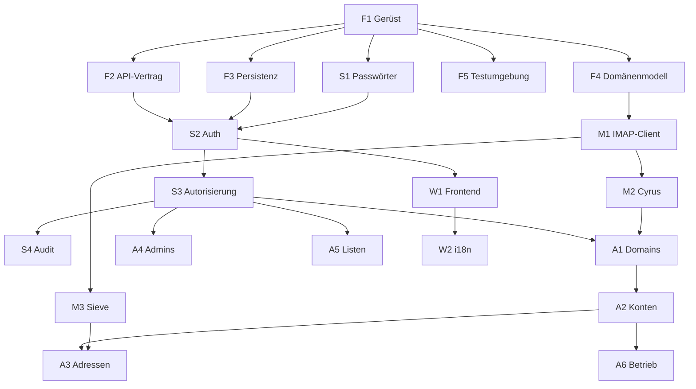

<!-- markdownlint-disable MD013 MD024 MD060 -->

# Detailkonzept

Zerlegt das Vorhaben in Arbeitspakete, die einzeln und weitgehend parallel bearbeitet werden
können. Jedes Paket hat ein eigenes Dokument unter [features/](features/) mit Zielsetzung,
Abgrenzung, Vorgaben, offenen Punkten und Abnahmekriterien.

Dieses Dokument beschreibt, **wie** die Pakete zusammenhängen und was für alle gilt. Die
fachlichen und technischen Grundlagen stehen in [03-architektur.md](03-architektur.md), die
verbindlichen Regeln in [CLAUDE.md](../CLAUDE.md).

> **Stand:** 2026-07-26

---

## 1. Wie ein Paket bearbeitet wird

Ein Auftrag lautet: *„Arbeite `docs/features/A2-konten.md` aus"* oder *„implementiere A2"*.

**Pflichtlektüre für jede Bearbeitung**, in dieser Reihenfolge:

1. [CLAUDE.md](../CLAUDE.md) — die nicht verhandelbaren Regeln
2. Die im Paketdokument genannten Abschnitte aus [03-architektur.md](03-architektur.md)
3. Das Paketdokument selbst

**Ein Paket, ein Bearbeiter.** Pakete sind so geschnitten, dass sie sich möglichst wenig
überschneiden. Wo zwei Pakete dieselbe Datei berühren, steht das in beiden Dokumenten unter
*Abhängigkeiten*.

**Offene Punkte werden nicht stillschweigend entschieden.** Jedes Paketdokument hat einen
Abschnitt *Zu klärende Punkte*. Was dort steht, wird beantwortet und im Dokument festgehalten,
bevor die betroffene Stelle umgesetzt wird — oder es wird eine Annahme getroffen, die
ausdrücklich als solche markiert ist.

---

## 2. Aufbau eines Paketdokuments

Vorlage: [features/\_template.md](features/_template.md)

| Abschnitt | Inhalt |
|---|---|
| **Ziel** | Was am Ende funktioniert, in ein bis drei Sätzen |
| **Abgrenzung** | Was ausdrücklich *nicht* dazugehört, mit Verweis auf das zuständige Paket |
| **Abhängigkeiten** | Pakete, die vorher fertig sein müssen; geteilte Dateien |
| **Vorgaben** | Architekturentscheidungen, die hier gelten — mit Abschnittsverweis |
| **Artefakte** | Konkret zu erstellende Dateien und Bausteine |
| **Zu klärende Punkte** | Offene Fragen, die vor oder während der Umsetzung beantwortet werden |
| **Definition of Done** | Prüfbare Abnahmekriterien |
| **Testfälle** | Was mindestens getestet wird, auf welcher Stufe |

---

## 3. Paketübersicht

### Fundament

| ID | Titel | hängt ab von |
|---|---|---|
| [F1](features/F1-projektgeruest.md) | Projektgerüst und Konfiguration | — |
| [F2](features/F2-api-vertrag.md) | API-Vertrag und Dispatcher | F1 |
| [F3](features/F3-persistenz-migrator.md) | Persistenz und Migrator | F1 |
| [F4](features/F4-domaenenmodell.md) | Domänenmodell | F1 |
| [F5](features/F5-testumgebung.md) | Testumgebung mit Docker | F1 |

### Sicherheit

| ID | Titel | hängt ab von |
|---|---|---|
| [S1](features/S1-passwortverfahren.md) | Passwortverfahren | F1 |
| [S2](features/S2-authentifizierung.md) | Authentifizierung und Token | F2, F3, S1 |
| [S3](features/S3-autorisierung.md) | Autorisierung | F2, F3, S2 |
| [S4](features/S4-revisionsprotokoll.md) | Revisionsprotokoll | F3, S3 |

### Mailstore

| ID | Titel | hängt ab von |
|---|---|---|
| [M1](features/M1-imap-client.md) | IMAP-Client | F1, F4 |
| [M2](features/M2-cyrus-mailstore.md) | Cyrus-Mailstore-Adapter | M1, F4 |
| [M3](features/M3-sieve.md) | ManageSieve und Sieve-Modell | M1, F4 |

### Fachliche Features

| ID | Titel | hängt ab von |
|---|---|---|
| [A1](features/A1-domains.md) | Domains | F2, F3, F4, S3, M2 |
| [A2](features/A2-konten.md) | Konten | A1, S1, M2 |
| [A3](features/A3-adressen.md) | Adressen, Aliase, Catchall, Weiterleitungen, Abwesenheit | A2, M3 |
| [A4](features/A4-administratoren.md) | Administratoren | S3, S1 |
| [A5](features/A5-mailinglisten.md) | Mailinglisten | F2, F3, S3 |
| [A6](features/A6-betrieb.md) | Abgleich, Reparaturwarteschlange, Zustandsprüfung | A2, M2, F3 |

### Oberfläche

| ID | Titel | hängt ab von |
|---|---|---|
| [W1](features/W1-frontend-geruest.md) | Frontend-Gerüst | F2, S2 |
| [W2](features/W2-mehrsprachigkeit.md) | Mehrsprachigkeit | W1 |

Die Oberflächen der Fachbereiche gehören jeweils zum betreffenden A-Paket, nicht zu W1. W1
liefert Gerüst, Anmeldung, API-Client, Fehlerbehandlung und Navigation.

---

## 4. Reihenfolge



### Stufen

| Stufe | Inhalt | Ergebnis |
|---|---|---|
| **1 — Gerüst** | F1, F2, F3, F4, F5 | Die API startet, validiert gegen das Schema, migriert, hat ein Domänenmodell und eine Testumgebung. Noch keine Fachlichkeit. |
| **2 — Zugang** | S1, S2, S3, S4 | Anmeldung, Token, Berechtigungen, Revisionsprotokoll. Ab hier ist jeder weitere Endpunkt abgesichert. |
| **3 — Mailstore** | M1, M2, M3 | Cyrus und Sieve sind ansprechbar und gegen die Testumgebung geprüft. |
| **4 — Fachlichkeit** | A1, A2, A3, A4, A5, A6 | Funktionale Parität mit webcyradm plus Revisionsprotokoll und Abgleich. |
| **5 — Oberfläche** | W1, W2 und die Ansichten der A-Pakete | Benutzbares Werkzeug. |

Stufe 3 kann parallel zu Stufe 2 laufen — die Mailstore-Pakete brauchen weder Auth noch
Autorisierung. Ebenso kann W1 beginnen, sobald S2 steht.

---

## 5. Was ein Bearbeiter nicht allein entscheidet

Diese Punkte werden **eskaliert**, nicht im Paket entschieden. Sie berühren Zusagen, die über
das einzelne Paket hinausreichen.

| Fall | Warum |
|---|---|
| Änderung an einer webcyradm-Tabelle oder an den Views `allusers` / `validsenders` | Postfix und `pam_mysql` lesen mit. Ein Fehler legt Zustellung oder Anmeldung lahm. |
| Nicht-additive Migration (`DROP`, `RENAME`, Typverengung) | Bricht den Parallelbetrieb mit webcyradm. |
| Neue Composer- oder npm-Abhängigkeit | Die schlanke Abhängigkeitsliste ist eine Entscheidung (E-12), kein Zufall. |
| Änderung am Passwortverfahren für `accountuser` | Muss `crypt(3)`-lesbar bleiben, sonst brechen IMAP und SMTP-AUTH. |
| Änderung an Token-Laufzeit, Speicherort oder Erneuerungsmechanismus | E-10 und E-15 sind abgewogene Entscheidungen inklusive Restrisiko. |
| Jede weitere Lockerung der Content-Security-Policy | Sie trägt das Risiko aus E-15. `style-src 'unsafe-inline'` ist mit U-35 für Material UI bereits entschieden und damit erledigt; alles darüber hinaus — insbesondere an `script-src` — wird eskaliert. |
| Änderung der Reihenfolge bei Operationen über Datenbank und Mailstore | Die Reihenfolge folgt dem Schadensbild, nicht der Bequemlichkeit. |
| Brechende Änderung am OpenAPI-Vertrag nach dem ersten Release | Clients und generierte Typen hängen daran. |
| Jeder schreibende Zugriff auf ein Produktivsystem | Braucht ausdrückliche Freigabe für den konkreten Vorgang. |
| Aufnahme echter Domains, Konten oder Hashes in Fixtures | Trägt Produktivdaten ins Repository (E-5). |

---

## 6. Übergreifende Abnahmekriterien

Gilt für **jedes** Paket, zusätzlich zu dessen eigener Definition of Done:

- **Vertrag zuerst.** Jede API-Änderung beginnt in `openapi/openapi.yaml`. Handler ohne
  Operation und Operation ohne Handler brechen den Build.
- **Berechtigung deklariert.** Jede Operation trägt `x-permission`. Fehlt sie, wird nichts
  durchgelassen.
- **Kein SQL aus Strings.** Prepared Statements ausnahmslos, auch bei Sortier- und
  Filterparametern.
- **Fehler mit stabilem Code.** `problem+json` mit `code`-Feld; der Text wird im Frontend
  übersetzt, nicht im Backend.
- **Keine festverdrahteten Oberflächentexte.** Alles über Textschlüssel.
- **Zustandsänderungen im Revisionsprotokoll.** Jede schreibende Operation schreibt nach
  `mailadmin_audit`.
- **Keine Geheimnisse im Log.** Passwörter, Hashes und Token werden nie geloggt, auch nicht
  gekürzt.
- **Keine Produktivdetails** in Code, Kommentaren, Fixtures oder veröffentlichten Dokumenten.
- **Tests auf der passenden Stufe** (Abschnitt 12.3 der Architektur). Ein Paket ohne Tests ist
  nicht fertig.
- **Das Paketdokument ist aktuell.** Beantwortete offene Punkte werden dort eingetragen, nicht
  nur im Code umgesetzt.

---

## 7. Verzeichnis der Paketdokumente

```text
docs/
  04-detailkonzept.md      dieses Dokument
  features/
    _template.md           Vorlage
    F1-projektgeruest.md
    F2-api-vertrag.md
    F3-persistenz-migrator.md
    F4-domaenenmodell.md
    F5-testumgebung.md
    S1-passwortverfahren.md
    S2-authentifizierung.md
    S3-autorisierung.md
    S4-revisionsprotokoll.md
    M1-imap-client.md
    M2-cyrus-mailstore.md
    M3-sieve.md
    A1-domains.md
    A2-konten.md
    A3-adressen.md
    A4-administratoren.md
    A5-mailinglisten.md
    A6-betrieb.md
    W1-frontend-geruest.md
    W2-mehrsprachigkeit.md
```
