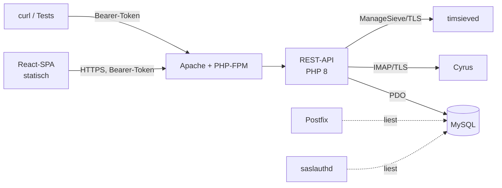

<!-- markdownlint-disable MD013 MD024 MD060 -->

# mailadmin

Eine Weboberfläche zur Verwaltung von Maildomains, Mailkonten, Aliassen, Weiterleitungen,
Quotas und Abwesenheitsnotizen auf einem Mailserver aus **Postfix**, **Cyrus IMAP** und
**MySQL/MariaDB**.

mailadmin ist der Nachfolger von [web-cyradm](https://github.com/web-cyradm/web-cyradm) und
arbeitet **auf dessen Datenbankschema weiter**. Eine bestehende Installation kann damit
umgestellt werden, ohne Konten neu anzulegen, Postfächer zu migrieren oder Nutzer zu neuen
Zugangsdaten zu zwingen.

> **Status:** Implementiert, vor dem ersten Release. Installation:
> [deployment/installation.md](deployment/installation.md).

---

## Warum ein Nachfolger

web-cyradm ist seit 2011 unverändert. Die letzte Fassung läuft nur unter PHP 5, das seit
Januar 2019 keine Sicherheitsupdates mehr erhält. Eine Bestandsaufnahme des Codes förderte
unter anderem zutage:

- über 100 SQL-Statements, die Werte aus `$_GET`/`$_POST` per String-Verkettung
  zusammensetzen — einschließlich des Login-Pfads, also **vor** der Authentifizierung
- Passwort-Hashing über `crypt($password, $password)`: das Passwort ist sein eigenes Salt,
  wodurch die ersten beiden Zeichen aus dem Hash ablesbar sind und bei DES-crypt nur die ersten
  acht Zeichen überhaupt geprüft werden
- kein CSRF-Schutz bei zustandsändernden Operationen, von denen einige über `GET` laufen —
  ein Bildaufruf in einer E-Mail genügt, um als angemeldeter Superuser eine Domain zu löschen
- Klartext-Zugangsdaten in einer Konfigurationsdatei im DocumentRoot
- unverschlüsselte IMAP-Adminverbindung mit Klartext-Passwort
- kein Revisionsprotokoll: wer wann was geändert hat, ist nicht nachvollziehbar

Dazu kommen funktionale Lücken. Domain-Umbenennung etwa ändert nur die Datenbank und lässt die
Postfächer unter dem alten Namen zurück — die Konten sind danach nicht mehr erreichbar.

mailadmin behebt diese Punkte, behält aber die Datenhaltung bei, damit der Umstieg ohne
Betriebsunterbrechung möglich ist.

---

## Was mailadmin verwaltet

| Bereich | Umfang |
|---|---|
| **Domains** | Anlegen, ändern, löschen; Kontingente für Kontenzahl und Speicher; Standardordner |
| **Konten** | Anlegen, ändern, löschen; Passwort setzen; Quota lesen und setzen |
| **Adressen** | Weitere Adressen je Konto, Aliase, Catchall je Domain |
| **Weiterleitungen** | Nach intern und extern, mit und ohne lokale Kopie |
| **Abwesenheit** | Abwesenheitsnotizen über Sieve |
| **Mailinglisten** | Verwaltung der Listeneinträge |
| **Administratoren** | Superuser und Domainmaster mit Domain-Zuschnitt |
| **Betrieb** | Revisionsprotokoll, Abgleich Datenbank ↔ Mailstore, Zustandsprüfung |

**Nicht im Umfang:** Selbstbedienung für Endnutzer. mailadmin ist ein reines
Administrationswerkzeug; Endnutzer greifen über ihren Mail-Client oder ein Webmail auf ihr
Postfach zu.

Ebenfalls nicht im Umfang: das Erzeugen von Serverkonfiguration. mailadmin schreibt
ausschließlich in die Datenbank. DKIM-Schlüssel, Cyrus-`loginrealms`, DNS-Einträge und
vHost-Konfiguration bleiben Sache des Konfigurationsmanagements der jeweiligen Installation.

---

## Voraussetzungen

| Komponente | Anforderung |
|---|---|
| Postfix | mit `mysql`-Maps für `virtual_alias_maps`, `mydestination`, `smtpd_sender_login_maps` |
| Cyrus IMAP | 3.x, mit ManageSieve; Adminzugang über IMAPS |
| Authentifizierung | `saslauthd` mit `pam_mysql`, `crypt=1` (also `crypt(3)`) gegen den View `allusers` |
| Datenbank | MariaDB mit dem web-cyradm-Schema (die Migrationen nutzen `ADD COLUMN IF NOT EXISTS`, U-34) |
| PHP | 8.3 oder neuer (U-1), mit `pdo_mysql`, `openssl`, `sodium`, `mbstring` |
| Webserver | Apache oder nginx mit PHP-FPM, HTTPS |
| Bau | Composer und Node 20 oder neuer — nur zum Bauen, nicht zur Laufzeit |

mailadmin ist für genau diesen Aufbau gebaut. Es ist bewusst **kein** universelles Werkzeug
mit austauschbarem Mailstore oder Datenbank-Backend — die Annahmen sind dokumentiert statt
konfigurierbar. Ein späterer Wechsel auf Dovecot ist durch eine Mailstore-Schnittstelle
vorbereitet, aber nicht implementiert.

---

## Architektur in Kurzform



Fünf Punkte, die den Entwurf prägen:

1. **Die Datenbank ist geteiltes Gebiet.** Postfix und `saslauthd` lesen dieselben Tabellen.
   Das Altschema wird nicht verbogen, sondern in der Repository-Schicht eingekapselt;
   Erweiterungen sind rein additiv und tragen das Präfix `mailadmin_`.
2. **Das OpenAPI-Schema ist der Vertrag.** Aus einer handgeschriebenen Datei entstehen die
   Routentabelle, die Validierung eingehender Anfragen, die TypeScript-Typen des Frontends,
   die Dokumentation und die Vertragstests. Fehlt zu einer Operation ein Handler oder
   umgekehrt, schlägt der Build fehl.
3. **Datenbank und Mailstore sind nicht transaktional koppelbar.** Jede Operation, die beide
   berührt, hat eine festgelegte Reihenfolge nach Schadensbild — beim Anlegen zuerst der
   Mailstore, beim Löschen zuerst die Datenbank —, eine Kompensation und eine
   Reparaturwarteschlange.
4. **Deny by default.** Jede Operation deklariert im Schema die nötige Berechtigung; eine
   Operation ohne Deklaration lässt der Build nicht durch. Jeder Anwendungsfall bekommt einen
   Akteurskontext als Pflichtparameter.
5. **Schlanke Backend-Seite.** Kein Full-Stack-Framework: eine PSR-15-Middleware-Kette,
   FastRoute, PHP-DI, `firebase/php-jwt`, ein OpenAPI-Validator und Monolog. Kein ORM — über
   einem Schema mit Pseudoschlüsseln und mehrfach überladenen Tabellen wäre es eine Last.

Ausführlich in [03-architektur.md](03-architektur.md).

---

## Technische Eckpunkte

**Authentifizierung.** JWT als Bearer-Token, 60 Minuten gültig, dazu ein undurchsichtiges
Erneuerungstoken mit 12 Stunden absoluter Laufzeit, Rotation bei jeder Nutzung und Erkennung
von Wiederverwendung. Widerruf über eine `jti`-Sperrliste, damit ein Abmelden sofort wirkt.

Im Browser liegt das Zugriffstoken im `localStorage`, das Erneuerungstoken dagegen in einem
HttpOnly-Cookie. Damit ist das Zugriffstoken bei einer XSS-Lücke abgreifbar — begrenzt auf
60 Minuten, weil das Erneuerungstoken für JavaScript unerreichbar bleibt. Getragen wird diese
Abwägung von einer Content-Security-Policy mit `script-src 'self'` und ohne `unsafe-eval` — der
Diebstahl eines Tokens setzt Skriptausführung voraus, und genau die bleibt ausgeschlossen. Für
Stile lässt die Policy `'unsafe-inline'` zu, weil Material UI zur Laufzeit styled; externe
Ursprünge sind nirgends erlaubt.

Der Domain-Zuschnitt steht bewusst **nicht** im Token, sondern wird pro Anfrage gelesen. Sonst
wirkte eine entzogene Zuweisung bis zu 60 Minuten weiter.

**Passwörter.** Neu gesetzte Passwörter werden modern gehasht: Argon2id für
Administratorkonten, bcrypt für Mailkonten. Bcrypt deshalb, weil `pam_mysql` mit `crypt=1`
mitliest und `crypt(3)` das Format verstehen muss — verifiziert bis hinunter zur
`libcrypt`-Ebene und end-to-end gegen IMAP und SMTP-AUTH.

Bestandshashes älterer Verfahren bleiben gültig und funktionieren unverändert weiter. Es gibt
keine Zwangsumstellung; stattdessen zeigt die Kontenliste das Hash-Format an und lässt danach
filtern. Administratorkonten werden bei der Anmeldung geprüft und bei Bedarf automatisch neu
gehasht — dort hängt kein weiterer Konsument an der Tabelle.

**Namensschema.** Cyrus kann Konten als `local.domain.tld` oder als `local@domain.tld` führen.
Welches Schema **neue** Konten bekommen, ist konfigurierbar — global und je Domain. Das Schema
eines bestehenden Kontos wird dagegen immer aus dem gespeicherten Benutzernamen erkannt und nie
überschrieben, damit ein Konto stets dem Namen folgt, unter dem seine Mailbox tatsächlich liegt.

Ein Konto zwischen den Schemata zu bewegen ist eine ausdrücklich zu bestätigende Operation, kein
Schalter: sie erfordert `renamemailbox`, und der Nutzer muss seine Zugangsdaten im Mail-Client
ändern.

**Sieve.** Skripte werden aus einem strukturierten Modell vollständig erzeugt, nie
gelesen-und-gepatcht. Erzeugte Skripte tragen eine Markierung; ein aktives Skript ohne diese
Markierung wird nicht überschrieben, sondern schreibgeschützt angezeigt.

**Schemamigration.** Die Anwendung bringt ihren Migrator mit. Er läuft über ein
CLI-Kommando unter Datenbanksperre; die Weboberfläche prüft nur die Version und verweigert bei
Rückstand den Dienst. Für einfache Installationen gibt es einen einschaltbaren Schalter, der
die Migration beim ersten Zugriff ausführt.

**Mehrsprachigkeit.** Von Beginn an eingeplant. Alle Oberflächentexte laufen über Textschlüssel;
die API bleibt sprachneutral und liefert je Fehler ein stabiles `code`-Feld, das das Frontend
übersetzt. Ausgeliefert wird zunächst nur Deutsch.

---

## Entwicklung und Test

Die Testumgebung wird mit Docker aufgebaut: Datenbank, Postfix, Cyrus IMAP mit ManageSieve und
`saslauthd`/`pam_mysql` in einem Compose-Aufbau. Damit lässt sich die vollständige
Authentifizierungskette lokal durchlaufen — von `password_hash()` über den View `allusers` und
`pam_mysql` bis zur IMAP- und SMTP-Anmeldung.

Zwei Eigenheiten sind Absicht: die Umgebung bringt das Datenbankschema im **Ausgangszustand**
mit, damit der Migrator gegen ein Altschema getestet wird statt gegen ein leeres. Und
`autocreate_quota` steht auf `-1`, damit eine Anmeldung mit falschem Namensschema im Test
scheitert, statt still ein leeres Postfach anzulegen.

Testdaten sind ausschließlich synthetisch.

---

## Technologie

| Ebene | Wahl |
|---|---|
| Backend | PHP 8, PSR-7/15-Middleware-Kette ohne Full-Stack-Framework |
| Routing | FastRoute, Routentabelle aus dem OpenAPI-Schema kompiliert |
| Datenzugriff | PDO, ausschließlich Prepared Statements, Repositories mit explizitem SQL |
| API | REST, OpenAPI 3.1, Fehler als `application/problem+json` (RFC 9457) |
| Frontend | React als Single-Page-Application, statisch ausgeliefert |
| Komponenten | Material UI; Schriften und Symbole lokal gebündelt, kein CDN |
| Typen | aus dem OpenAPI-Schema generiert (`openapi-typescript`) |

Keine Offline-Fähigkeit, kein Service Worker: mailadmin ist ein Administrationswerkzeug hinter
Anmeldung, bei dem zwischengespeicherte Löschvorgänge ein Risiko wären, kein Komfortgewinn.

---

## Verzeichnisstruktur

```text
public/            einziges im Web-Root erreichbares Verzeichnis
  index.php        Front-Controller
  assets/          gebautes Frontend-Bundle
openapi/
  openapi.yaml     der API-Vertrag
src/
  Http/            Middleware, Dispatcher, Handler (einer je operationId)
  Application/     Anwendungsfälle, ohne HTTP-Kenntnis
  Domain/          Entitäten, Value Objects, Regeln — kein SQL, kein IMAP
  Infrastructure/
    Persistence/   Repositories, Migrator
    Mailstore/     Cyrus-Anbindung, IMAP- und ManageSieve-Client
    Security/      Token, Passwort-Hashing, Missbrauchsschutz
frontend/          React-Quellen
config/
migrations/
tests/
docs/
```

Anwendungscode, Konfiguration und Abhängigkeiten liegen **außerhalb** des DocumentRoot. Im
Web-Root steht ausschließlich `public/`.

---

## Dokumentation

| Datei | Inhalt |
|---|---|
| [README.md](README.md) | dieses Dokument |
| [03-architektur.md](03-architektur.md) | Architektur im Detail: Schichten, API-Vertrag, Authentifizierung, Autorisierung, Konsistenzmodell, Mailstore-Anbindung, Testumgebung, Frontend |
| [04-detailkonzept.md](04-detailkonzept.md) | Zerlegung in Arbeitspakete, Reihenfolge, Eskalationsregeln, übergreifende Abnahmekriterien |
| [features/](features/) | Ein Dokument je Arbeitspaket: Ziel, Abgrenzung, Vorgaben, offene Punkte, Abnahmekriterien, Testfälle |

Zusätzlich existieren interne Dokumente unter `docs/internal/`, die den konkreten
Produktivserver beschreiben — Bestandsaufnahme, Entscheidungsprotokoll und Domain-Inventar.
Sie enthalten Hostnamen, Domainlisten und Konfigurationsdetails und sind deshalb per
`.gitignore` von der Veröffentlichung ausgenommen. Das Architekturdokument verweist auf sie,
ist aber ohne sie lesbar.

---

## Sicherheitshaltung

Der Entwurf adressiert jeden Befund aus der Bestandsaufnahme; die vollständige Zuordnung steht
in [03-architektur.md, Abschnitt 14](03-architektur.md).

Bewusst offen bleibt ein Punkt: **Bestandsinstallationen können Passwort-Hashes in veralteten
Verfahren enthalten**, und mailadmin erzwingt deren Umstellung nicht. Ohne das Klartextpasswort
ist ein Hash nicht konvertierbar, und ein reines Administrationswerkzeug sieht die Passwörter
seiner Endnutzer nie. Statt einer Zwangsumstellung macht mailadmin den Zustand sichtbar und
stellt Werkzeuge für eine gezielte Umstellung bereit. Betreiber sollten diese Entscheidung für
ihre Installation bewusst treffen.

---

## Mitwirken

Fehlerberichte und Vorschläge sind willkommen. Zwei Hinweise vorab:

- **Kein SQL aus Strings.** Prepared Statements ohne Ausnahme, auch bei Sortier- und
  Filterparametern.
- **Der Vertrag zuerst.** Änderungen an der API beginnen im OpenAPI-Schema, nicht im Handler.

Weitere Konventionen in `CLAUDE.md` im Wurzelverzeichnis.

---

## Lizenz

[AGPL-3.0-or-later](../LICENSE) (U-23). web-cyradm steht unter der GPL; mailadmin ist eine
Neuentwicklung ohne Codeübernahme, bleibt mit einer Copyleft-Lizenz aber im selben Ökosystem.
